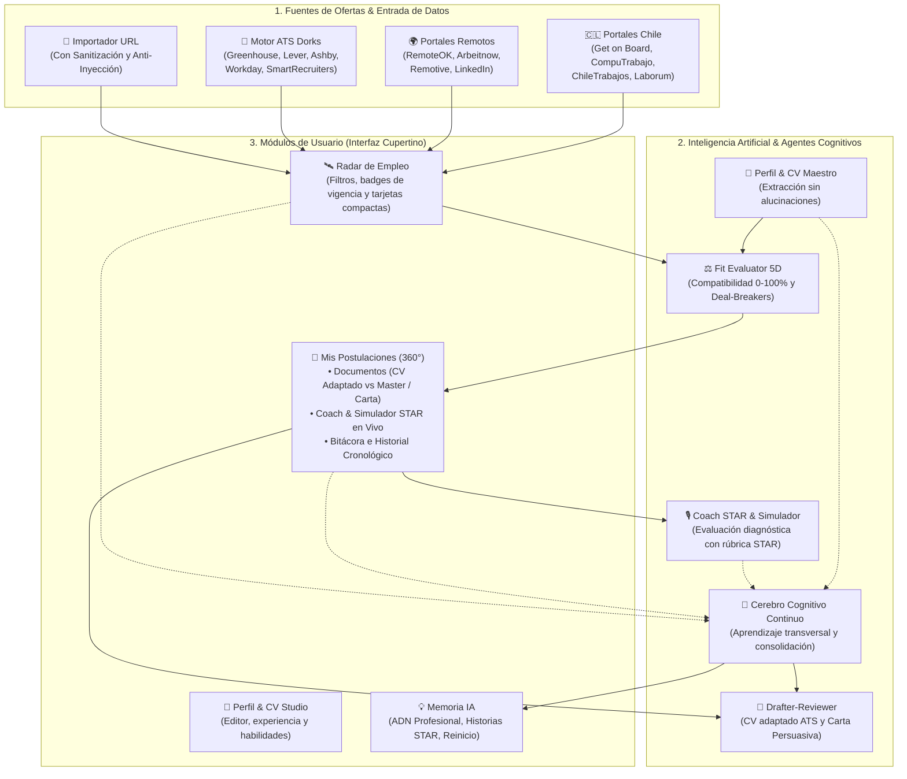
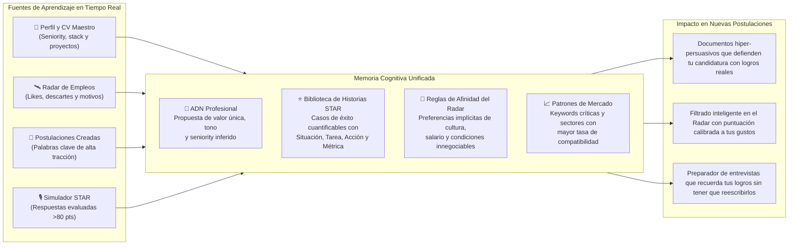
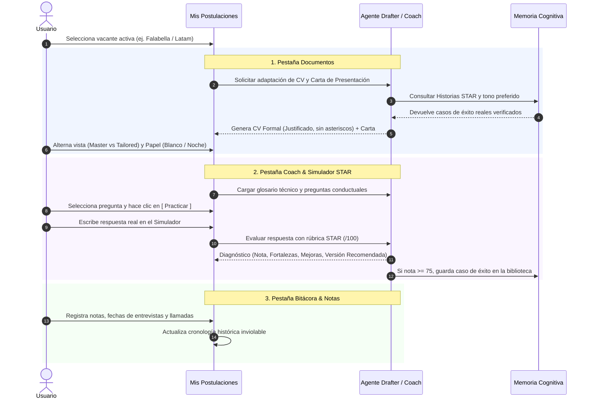

# NexusJob AI — Plataforma Autónoma de Búsqueda de Empleo, Memoria Cognitiva & Preparación de Entrevistas

> Un ecosistema inteligente y autónomo diseñado para transformar la búsqueda de empleo en una experiencia de alta precisión. Potenciado por modelos **Google Gemini**, **ChatGPT** y **Claude**, con cobertura exhaustiva para **mercados laborales en Chile y remotos globales**, provisto de una interfaz inspirada en el **diseño de Apple (Cupertino HIG)**, un **Cerebro Cognitivo de Memoria Continua** y un servidor **Model Context Protocol (MCP)** estándar.

---

## 🏗️ Arquitectura General del Sistema



---

## 🧠 Cerebro Cognitivo IA: Memoria Continua del Candidato

A diferencia de los sistemas tradicionales con preferencias estáticas o prompts genéricos, **NexusJob AI** cuenta con una **Memoria Cognitiva Multicapa** que aprende de forma continua y transversal de cada interacción del candidato en la plataforma:



### Funcionalidades de la Memoria IA:
* **Sincronización Profunda (`⚡ Sincronizar Memoria`)**: El candidato puede consolidar todo su historial con un clic; Gemini analiza el CV maestro, las vacantes guardadas y el histórico de postulaciones para recalibrar el ADN profesional y extraer historias STAR.
* **Calibración Dinámica**: Un medidor de madurez (`0% a 100%`) indica qué tan calibrada está la IA en función de los datos acumulados.
* **Reinicio de Fábrica Seguro (`Reiniciar Memoria`)**: Si el candidato desea reorientar su perfil o empezar desde cero, dispone de un botón de borrado total con diálogo de confirmación que limpia recuerdos y patrones aprendidos sin afectar su CV maestro ni sus vacantes guardadas.

---

## 🎯 Flujo de Postulación 360° & Coach STAR Integrado

El ciclo de postulación se encuentra completamente unificado en **Mis Postulaciones**, eliminando pestañas aisladas y brindando un flujo coherente por empresa:



---

## 🌟 Características Principales

### 1. Multi-LLM y Configuración Local Segura
- **Soporte Oficial de Google Gemini:** Modelos de última generación (`gemini-3.5-flash`, `gemini-3.8-flash`, `gemini-2.5-pro`) mediante el SDK oficial `google-genai` con fallback resiliente ante contingencias de cuota o servicio.
- **Compatibilidad con OpenAI & Anthropic:** Alterna con facilidad a **GPT-4o**, **GPT-4o-mini**, **Claude 3.5 Sonnet** o ingresa modelos personalizados para prevenir incompatibilidades con versiones descontinuadas.
- **Almacenamiento Local de Claves:** Tus API Keys y preferencias se almacenan localmente en tu equipo (`data/settings.json`), sin enviarse a servidores de terceros.
- **Indicador de Estado en Vivo (Navbar):**
  - 🟢 **Punto Verde + Modelo Activo:** IA conectada y lista para razonar.
  - 🟡 **Modo Offline Heurístico:** Operatividad inmediata sin API Key (búsqueda de empleo, navegación, seguimiento y guardado local).

### 2. Radar de Ofertas Laborales & Motor Inteligente ATS
- **Maximización del Mercado en Chile:** Conectores especializados para **Get on Board Chile, CompuTrabajo Chile, ChileTrabajos, Laborum Chile y LinkedIn Chile**.
- **Portales Globales Remotos:** Integración simultánea con **RemoteOK, Arbeitnow, Remotive y LinkedIn Global**.
- **Directorio de Empresas Corporativas y ATS (Chile & Global):** Base de datos categorizada con más de 100 empresas líderes en Chile e Internacionales, identificando su ATS corporativo (**Workday, Greenhouse, Lever, Ashby, SmartRecruiters, SuccessFactors, Taleo**).
- **Generador y Ejecutor de Consultas Booleanas (ATS Dorks):** Indexa ofertas reales desde portales corporativos limpios sin intermediarios ni muros de registro.
- **Filtro de Alcance Instantáneo:** Alterna con un solo clic entre *Todos (Chile + Global)*, *Solo Chile* y *Solo Global Remoto*.
- **Control de Vistas en Cards Compactas:** Configura la cuadrícula en **3 Cards por fila**, **2 Cards por fila** o **Vista de Lista** para maximizar la visibilidad.

### 3. Visualización y Calidad Tipográfica Formal de Documentos
- **Limpieza Rigurosa de Formato Markdown:**
  - Supresión automática de asteriscos crudos `*` y separadores de guiones `---` en la previsualización. Los títulos, subtítulos, cargos y viñetas se renderizan como componentes HTML nativos de alta fidelidad.
- **Justificación Formal de Documentos (`.formal-justify`):**
  - Justificación de texto formal con prevención de espaciados exagerados mediante `text-align-last: left`, `text-justify: inter-word` y separación silábica automática (`hyphens: auto`).
  - Alternador en barra de herramientas entre **Justificado Formal** y **Alineación Izquierda ATS**.
- **Selector de Papel de Contraste:**
  - **Hoja Blanca Formal (`paperTheme: light`)**: Hoja de papel blanco impoluto con tipografía oscura de alta legibilidad, ideal para lectura y exportación a PDF.
  - **Hoja Noche (`paperTheme: dark`)**: Modo oscuro optimizado para ambientes de poca luz con tipografía clara.
- **Selector de Versión de CV (Tailored vs Master)**:
  - Alterna al instante entre el **CV Adaptado por la IA** para esa empresa o el **CV Maestro General** sin perder modificaciones.
- **Edición Inline de Fechas y Textos**:
  - Corrección directa de inconsistencias (ej. "Octubre 2026 – Presente" cuando ya concluyó) con sincronización automática en el perfil.

### 4. Coach & Simulador STAR Integrado
- **Simulador Interactivo en Tiempo Real**: Entrena tus respuestas técnicas y conductuales directamente en la vista de la postulación.
- **Diagnóstico IA Inmediato**: Evaluación con nota `/100`, listado de fortalezas detectadas, oportunidades de mejora y una **versión recomendada de alto impacto**.
- **Botón `[ Practicar ]` en cada Pregunta**: Haz clic sobre cualquier pregunta técnica o conductual de la empresa para cargarla de inmediato en el simulador.
- **Estrategia Salarial y Preguntas Capciosas**: Consejos tácticos sobre cómo plantear pretensiones de renta líquida y argumentar motivos de cambio de empleo.
- **Preguntas Inteligentes**: Banco de preguntas estratégicas para que el candidato destaque haciéndole preguntas al entrevistador al final de la sesión.

---

## 🎨 Principios de Diseño Apple (Cupertino HIG)
- **Glassmorphism Frosted:** Fondos translúcidos con desenfoque (`backdrop-filter: blur(20px)`), bordes hiperfinos y tipografía del sistema (`-apple-system`, `SF Pro Display`).
- **Navegación Consolidada en 4 Pilares**:
  1. **Radar de Empleo**: Descubrimiento y filtrado de vacantes.
  2. **Mis Postulaciones**: Documentos adaptados, Coach & Simulador STAR y Bitácora de seguimiento.
  3. **Perfil & CV**: Edición de trayectoria, habilidades y formación.
  4. **Memoria IA**: Centro de mando cognitivo, ADN profesional e historias STAR.

---

## 🚀 Inicio Rápido

### Opción A: Lanzador en 1 Clic (Windows)
Haz doble clic sobre:
```bash
start_app.bat
```
*(O ejecuta `./start_app.ps1` en PowerShell).*  
Instala automáticamente el entorno virtual, levanta el backend FastAPI y abre la aplicación en tu navegador.

### Opción B: Ejecución Manual

1. **Backend (FastAPI):**
   ```bash
   python -m venv venv
   .\venv\Scripts\activate
   pip install -r backend/requirements.txt
   cd backend
   python -m uvicorn app.main:app --host 127.0.0.1 --port 8000
   ```

2. **Frontend (React + Vite + TailwindCSS):**
   ```bash
   cd frontend
   npm install
   npm run dev
   ```
   Abre **http://localhost:3000** en tu navegador.

---

## 🔌 Conexión MCP (Model Context Protocol)

Puedes vincular este agente a **Gemini CLI**, **Claude Code**, **Cursor** o **ChatGPT**:

Agrega a tu configuración MCP (`claude_desktop_config.json` o settings de tu entorno):

```json
{
  "mcpServers": {
    "nexusjob-ai": {
      "command": "python",
      "args": ["run_mcp.py"],
      "cwd": "C:/Users/.../Agente busca empleo Gemini",
      "env": {
        "GEMINI_API_KEY": "tu_clave_de_gemini"
      }
    }
  }
}
```

### Herramientas MCP Disponibles:
- `search_remote_jobs(keywords, remote_only, scope, limit)`
- `evaluate_job_fit(job_id_or_url)`
- `tailor_application(job_id)`
- `track_job(job_id)`
- `add_job_history(job_id, event_type, title, notes)`
- `get_candidate_profile()`
- `record_feedback_and_learn(job_id, action, notes)`
- `consolidate_ai_memory()`

---

## 📁 Estructura del Proyecto

```
Agente busca empleo Gemini/
├── backend/
│   ├── app/
│   │   ├── main.py                  # API REST FastAPI, tracking y endpoints de memoria
│   │   ├── config.py                # Ajustes de entorno, llaves y rutas
│   │   ├── mcp_server.py            # Servidor MCP estándar JSON-RPC
│   │   ├── models/schemas.py        # Modelos Pydantic (JobPosting, Tracking, ProfileDNA, STAR)
│   │   ├── storage/db.py            # Persistencia de Radar, Postulaciones y Memoria
│   │   ├── storage/companies_seed.py# Directorio seed de empresas líderes y portales ATS
│   │   ├── scrapers/                # Scrapers de Chile, Globales y Motor ATS Dorks
│   │   └── agents/
│   │       ├── drafter_reviewer.py  # Adaptador de CV con Historias STAR y Revisor ATS
│   │       ├── preference_learner.py# Motor de Consolidación Cognitiva y Aprendizaje Continuo
│   │       ├── fit_evaluator.py     # Evaluador de Ajuste 5D y Deal-Breakers
│   │       ├── interview_coach.py   # Generador de kits y Evaluador de Respuestas STAR
│   │       ├── llm_provider.py      # Proveedor Multi-LLM resiliente (Gemini / OpenAI / Claude)
│   │       ├── profile_analyzer.py  # Analizador de CV y extracción de experiencia
│   │       └── role_recommender.py  # Deductor dinámico de familias de roles ATS
│   ├── requirements.txt
│   └── run.py
├── frontend/
│   ├── src/
│   │   ├── components/
│   │   │   ├── JobRadar.tsx         # Radar de búsqueda, cards compactas y filtros
│   │   │   ├── PipelineTracker.tsx  # Documentos, Coach & Simulador STAR y Bitácora
│   │   │   ├── PreferencesCenter.tsx# Centro de Mando de Memoria Cognitiva e Historias STAR
│   │   │   ├── ProfileStudio.tsx    # Editor de CV Maestro y experiencia
│   │   │   ├── SettingsModal.tsx    # Configuración de LLM, modelos y API keys
│   │   │   ├── Toast.tsx            # Sistema de notificaciones minimalistas Cupertino
│   │   │   └── Navbar.tsx           # Barra de navegación consolidada en 4 pilares
│   │   ├── utils/dateUtils.ts       # Cálculos de fechas, vigencias y badges fidedignos
│   │   ├── types.ts                 # Tipos TypeScript compartidos (STAR, Memory, DNA)
│   │   └── api.ts                   # Cliente de conexión REST
│   ├── package.json
│   └── vite.config.ts
├── data/                            # Almacenamiento local persistente (perfil, postulaciones, memoria)
├── start_app.bat                    # Lanzador rápido Windows
└── README.md
```

---

## 🛡️ Seguridad, Privacidad e Integridad
- **Almacenamiento Local Estricto:** Tus datos personales, currículum vitae, notas de entrevistas y API keys residen únicamente en tu máquina local.
- **Protección de Datos en Seguimiento:** La limpieza del Radar no toca las ofertas en Seguimiento; las fechas y el historial se preservan de forma definitiva.
- **Cero Alucinaciones en CVs:** El pipeline Drafter-Reviewer reorganiza y resalta evidencia real de tu perfil, sin inventar ni exagerar competencias, apoyándose en tus historias STAR validadas.
